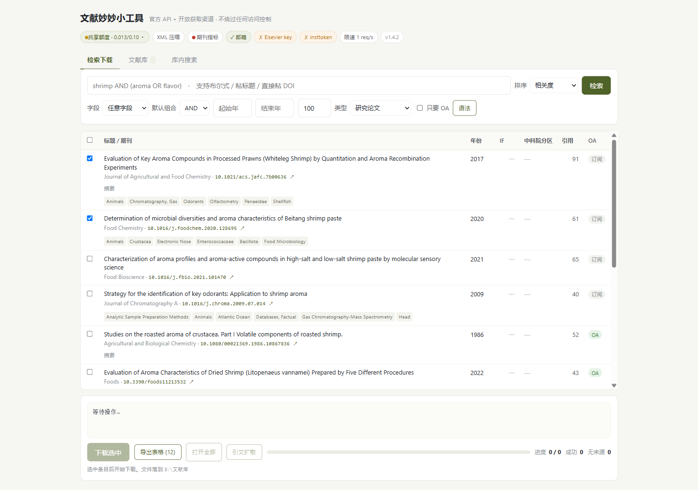
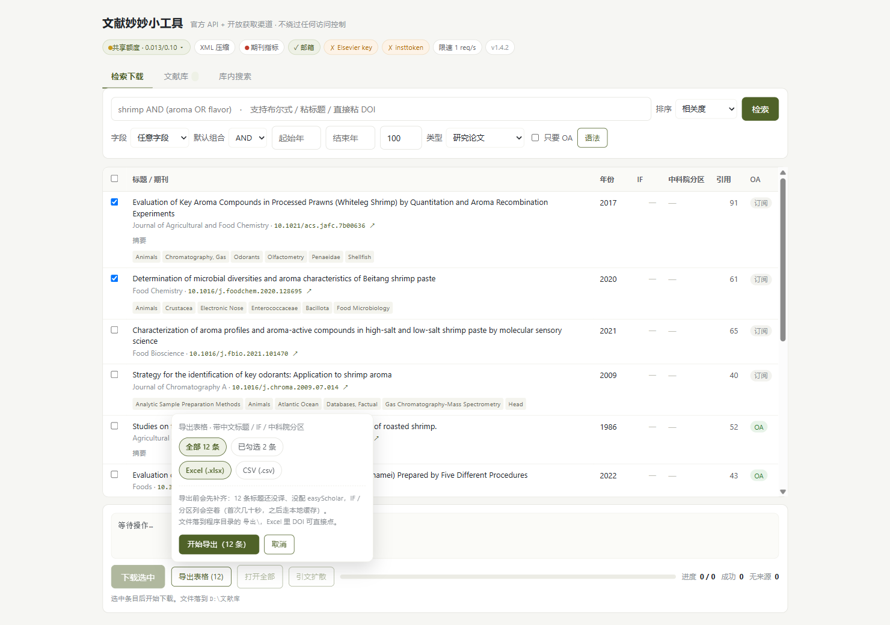
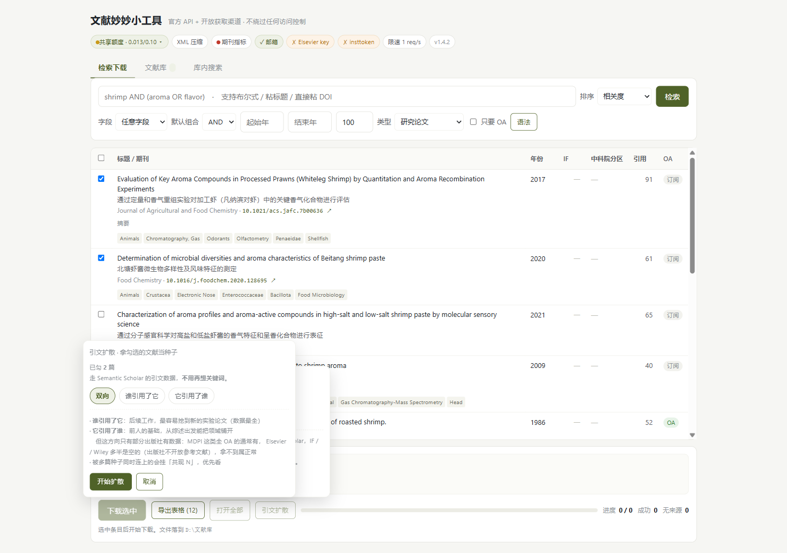
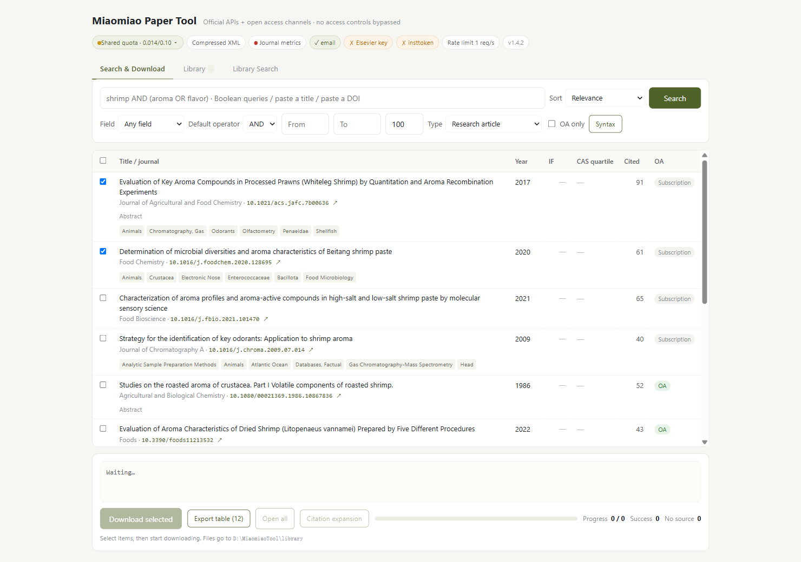
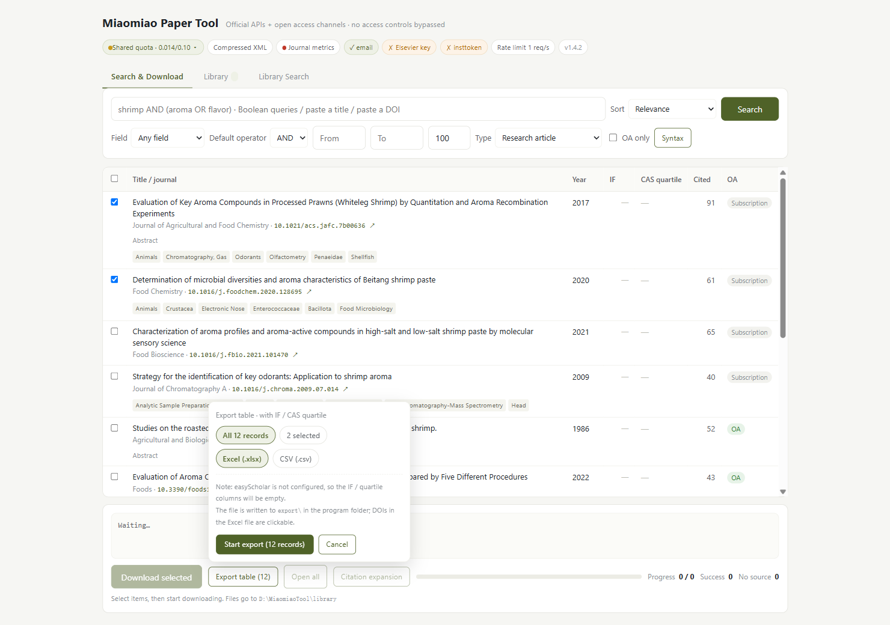
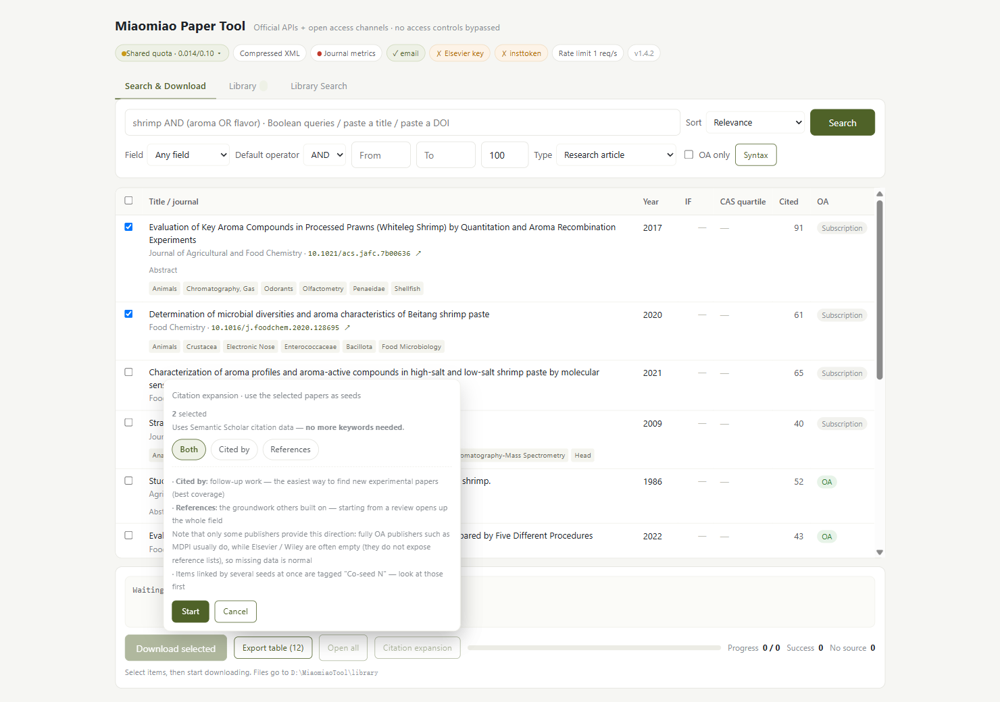

# 文献妙妙小工具 / Miaomiao Paper Tool

批量检索文献、自动拿全文的 Windows 小工具。走**官方 API** 和**开放获取渠道**，不爬网站、不绕过任何访问控制。

A Windows desktop tool for batch literature search and full-text retrieval. It talks to **official APIs** and **open-access channels** — no scraping, no bypassing access controls.

> 作者 / Author：Ni, Yishu & Da Feiyu（WorkBuddy · DeepSeek）　·　© 2026 Ni, Yishu
> 致谢 / Acknowledgement：Sun, Wenbin 对软件的试用与调试



---

## 📖 文档 / Documentation

完整文档只有 PDF，中英各一份：

| | 中文 | English |
|---|---|---|
| **使用说明**<br>User guide | [`使用说明.pdf`](使用说明.pdf)（21 页） | [`User-Guide-EN.pdf`](User-Guide-EN.pdf)（19 页） |
| **源码说明**<br>Source notes | [`docs/源码说明.pdf`](docs/源码说明.pdf)（4 页） | [`docs/Source-NOTES-EN.pdf`](docs/Source-NOTES-EN.pdf)（5 页） |

> 看中文说明书时先读第 1 节「用之前先看这 10 条」—— 尤其是 email 必填、订阅刊只能校园网内下载这两条。

---

## 功能 / Features

| 模块 | 做什么 |
|---|---|
| **检索** | OpenAlex 全文检索，支持布尔语法（`AND` / `OR` / `NOT` / 括号 / `"短语"` / 通配符）、字段前缀（`title:` `abstract:` `tiab:`）、5 种排序、按文献类型筛选（研究论文 / 综述 / 学位论文 / 预印本…） |
| **下载** | Unpaywall / arXiv / PMC / Europe PMC 拿开放获取全文；Elsevier 订阅刊走官方 Article Retrieval API。存成 PDF / XML / XML 压缩（默认，省 10 倍空间） |
| **导出** | 一键出 Excel（中文标题、文献类型、IF、中科院分区、JCR 分区、DOI 超链接）或 CSV |
| **待下载清单** | 自动生成 HTML 清单，标注出版社、记录下载进度，支持「打开接下来 5 篇」 |
| **整理下载** | 把浏览器里手动下到「下载」文件夹的 PDF 按正文 DOI 认出来 → 统一改名 → 归位到文献库 |
| **库内搜索** | 在自己文献库的摘要、笔记、检索记录里搜内容，中文可以直接搜英文文献 |
| **引文扩散** | 拿几篇核心文献当种子，顺着 Semantic Scholar 的引文网络找「谁引用了它」/「它引用了谁」 |
| **Zotero 联动** | 只读探测哪些已在库里；能直接建分类 + 写入条目（可一键撤销），也能生成 `.rdf` 手动导入 |
| **PubMed 校正** | 用 PubMed 的文献类型纠正 OpenAlex 的机器判断，并补 MeSH 主题词 |

## 截图 / Screenshots

| 检索结果 | 导出表格 | 引文扩散 |
|---|---|---|
|  |  |  |

> 截图里的检索结果是示例数据（用了真实存在的虾风味文献，方便看清界面长什么样）。

英文界面 / English UI:

| Search results | Export table | Citation expansion |
|---|---|---|
|  |  |  |

> 英文版界面与中文版一一对应，但文案全英文，默认目录名也换成了 `library/` `export/` `to-download.html`。

## 下载 / Download

GitHub 上有**两个 Release，功能完全相同**，差别只在附带的文档语言：

| 版本 | Tag | 下载的附件 | 说明 |
|---|---|---|---|
| **中文版**<br>Chinese | `v1.4.2` | `MiaomiaoTool-v1.4.2-zh.zip` | 中文界面 + 中文说明 |
| **English** | `v1.4.2-en` | `MiaomiaoTool-v1.4.2-en.zip` | **Fully English UI** + English docs |

> 两个包是同一份代码的两个构建：中文版界面全中文，英文版界面全英文（窗口、按钮、日志、报错、导出表头、Zotero 分类名都是英文），功能完全一样。
>
> 英文版的数据目录名也一并换成了英文：**文献库 → `library`、导出 → `export`、待下载清单 → `to-download.html`、说明文档 → `User-Guide.md`**。两个版本的数据目录不互通，换版本时把 `library` 里的文件拷进 `文献库`（或改 `config.json` 的 `library_dir` 指过去）即可。

下载后解压到 **D / E / F 盘**（C 盘紧张，程序会存不少 PDF），然后：

1. **先双击一次 exe**（中文包里叫 `文献妙妙小工具.exe`，英文包里叫 `MiaomiaoTool.exe`），
   看到窗口后关掉 —— 它会在同目录生成 `config.json`
2. 用记事本打开 `config.json`，把 `"email"` 填成你自己的邮箱

   ```json
   "email": "你的名字@学校.edu.cn",
   ```

   > 这一步不能省。邮箱传给 Unpaywall 做身份识别，不填的话开放获取链接解析不出来，**下载会全部失败**。

3. 再双击 `文献妙妙小工具.exe`，开始用

> **exe 没有数字签名**，第一次运行 Windows SmartScreen 会拦一下：点「更多信息」→「仍要运行」。
> 签名证书一年几千块，个人工具签不起。

从源码跑、自己打包、GitHub Actions 的用法见源码说明 PDF。

## ⚠️ 配置里是明文密钥

`config.json` 保存的是明文 key（Elsevier / OpenAlex / easyScholar）。**把这个文件夹发给任何人之前，先把这几个 key 清空**，或者直接用仓库里的 `config.example.json`（全空）。

## 合规 / Compliance

这个工具**不做**：

- 不绕过反爬机制，不伪造浏览器指纹，不用代理池轮换 IP
- 不抓取需要登录 / 订阅鉴权的页面
- 不接 Sci-Hub 之类的盗版源
- 不程序化访问 Google Scholar（其服务条款明确禁止，且有 CAPTCHA 与 IP 封禁）

原因很实际：出版社判定机器批量下载后的标准处理是**通知图书馆、停掉整个机构的 IP 访问 2–4 周**。一个人跑脚本，全院停摆，被通报的是当事人。

所以订阅刊只能给链接、让你在校园网里手动点——**这不是没做完，是故意的**。

下载的文献请遵守各自期刊的授权协议，仅用于个人科研阅读，不要二次分发。

## 已知限制（都是外部限制，不是没做）

- **OpenAlex 对综述标注极不全**。同一个检索式，真综述远多于被标 `review` 的条数。想找综述建议选「研究论文 + 综述」，再看界面上的橙色「综述」标
- **反向引文（它引用了谁）只有 OA 期刊有数据**。Elsevier / Wiley / Springer 基本是空的，MDPI 这类全 OA 的有
- **订阅刊没有 OA 副本就是没有**。实测再叠加 Semantic Scholar / OpenAIRE / CORE 等免费源，补漏率都在 10% 以内
- **中文文献基本搜不到**。知网不提供公开 API，元数据也不进入 OpenAlex / Crossref 这类国际学术图谱
- **PubMed 校正只覆盖生物医学期刊**。`LWT`、`Journal of Food Science` 这类很多不在 PubMed 里

## 技术栈 / Tech stack

Python 3.11+ · [pywebview](https://pywebview.flowrl.com/)（原生窗口）· 原生 HTML/CSS/JS（前端无框架）· SQLite FTS5（库内搜索）· PyInstaller

数据源：[OpenAlex](https://openalex.org/)（检索）· [Unpaywall](https://unpaywall.org/) / arXiv / PMC（开放获取全文）· [Elsevier Article Retrieval API](https://dev.elsevier.com/)（订阅刊）· [Semantic Scholar](https://www.semanticscholar.org/)（引文网络）· [NCBI E-utilities](https://www.ncbi.nlm.nih.gov/books/NBK25501/)（文献类型 / MeSH）· [easyScholar](https://www.easyscholar.cc/)（期刊指标）· [MyMemory](https://mymemory.translated.net/)（标题翻译）

## 源码与工具链 / Source layout

| 路径 | 说明 |
|---|---|
| `源码/` | 中文版源码（10 个 `.py` + `ui.html`） |
| `源码/en/` | 英文版源码，由 `tools/i18n/make_en.py` **生成** —— 不要手改，重跑会覆盖 |
| `tools/i18n/make_en.py` | 中文 → 英文源码生成器，三道校验：AST 骨架一致 / `py_compile` / 无中文残留 |
| `tools/i18n/dict.json` | 1362 条译文，键是中文原文 —— **改中文源码必须同步改键**，否则整套翻译失效 |
| `tools/i18n/smoke_ui.py` | 界面自检：14 个场景查文本截断、溢出视口、中文残留、JS 报错 |
| `tools/check_release.py` | 发布前核对：版本号、中英代码骨架、发布包内容、exe 内嵌前端 |

改完中文源码的完整链路：

```bash
python tools/i18n/make_en.py     # 重新生成 源码/en/（三道校验不过就失败）
python tools/i18n/smoke_ui.py    # 界面自检
python tools/check_release.py    # 发布前核对（可加 --packs / --home 查发布包与本地目录）
```

> 英文版不是另写一份代码：生成器按 `tokenize` / HTML 分段精确替换字面量与注释，代码结构不动。
> 除 `paperfetch_ui.py` 刻意移除中文翻译接口外，其余 9 个文件的 AST 与中文版逐节点一致。

## 许可 / License

个人学习与研究使用免费，**禁止商业用途**。详见 [LICENSE](LICENSE)。
Free for personal study and research; **commercial use prohibited**. See [LICENSE](LICENSE).
